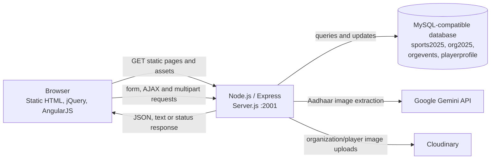

# Rallieu

Rallieu is a sports-event directory and organizer portal. It provides separate browser dashboards for players, sports organizations, and administrators, backed by an Express server and a MySQL-compatible database.

## Project Overview

The project is intended to help sports organizations publish event information and help players discover events. Organizations can maintain a profile, publish events, and remove event records. Players can maintain a profile and browse event details. An administrator interface can list accounts and change their active/blocked status.

The current implementation is a collection of static HTML pages with inline JavaScript and styles, served by a single Node.js process. It is an early-stage application: some user journeys are present only as a UI, and the limitations listed below should be considered before using it with real users or data.

## Key Features

### Shared account flows

- Sign up with an email address, password, and either the `Player` or `Organization` account type.
- The login UI is intended to route users to a player, organization, or administrator dashboard according to the returned account type. The current `/server-login` SQL contains placeholder text, so this flow requires a backend fix before it works.
- Store the signed-in email in browser `localStorage` for dashboard display and logout.
- Change-password controls are present in dashboards, but the corresponding SQL query in `Server.js` contains placeholder text and is not a working query as checked in.

### Players

- Create and edit a player profile with contact, location, sports, and “About” information.
- Upload an Aadhaar image and a profile image when creating a profile.
- On profile creation, request extraction of the Aadhaar holder's English name, date of birth, gender, and Aadhaar number using Gemini; store these values with the profile.
- Browse the event records returned by the server and open a detail view.

The player event page does not implement event registration, joining, or participant tracking. It currently fetches event records and displays details only.

### Organizations

- Create and update an organization profile, including registration details, location, sports, website/social handle, contact, and description.
- Upload an organization registration image; the server uploads images to Cloudinary and stores the returned URL.
- Publish event records with dates, location, sport, age range, registration deadline, fee, prize money, contact, and guest-of-honor details.
- View event rows in the organization management page and request removal of a row by organization email and event ID. The current list endpoint returns all event rows rather than filtering to the signed-in organization.

### Administrators

- View account records and request that an account be blocked or unblocked.
- Open the account console from the administrator dashboard.

The account type selector on the public sign-up form does not offer administrator registration.

## Technology Stack

| Area | Technologies found in the repository |
|---|---|
| Server | Node.js, CommonJS, Express `^5.2.1` |
| Database | MySQL-compatible database through `mysql2` `^3.22.1`; configured for Aiven via a connection URL |
| File upload handling | `express-fileupload` `^1.5.2` |
| Image storage | Cloudinary `^2.9.0` |
| AI | Google Gen AI SDK `@google/genai` `^2.32.0`, using the `gemini-3.5-flash-lite` model name in the server |
| Configuration | `dotenv` `^17.4.2` |
| Browser UI | HTML, inline CSS and JavaScript; Bootstrap 5.3.7 on most application pages, jQuery 3.7.1, and AngularJS 1.8.3 on dashboard/list pages |
| Other browser integrations | Font Awesome 7.0.1 and a Google Maps embed on the landing page |
| Package tooling | npm; dependency lockfile format version 3 |

These are the versions/ranges declared in `package.json`; browser libraries are loaded from external CDNs rather than installed as npm dependencies. The package also declares `file`, `file-upload`, `upload`, and `nodemon`; no development script is defined, and these packages are not part of the main request flow shown in `Server.js`.

## Project Architecture



`Server.js` starts an Express server on port `2001`, serves the `Public/` directory as static content, and defines the application endpoints in the same file. The browser sends form-encoded requests for ordinary fields and multipart requests for uploaded images. The server queries MySQL and returns text or JSON. For image-enabled workflows it calls Cloudinary; player-profile creation also sends the Aadhaar image to Gemini.

There is no separate frontend build, API router, authentication middleware, session store, or database migration framework in the repository.

## Repository Structure

```text
Rallieu/
├── .gitattributes
├── .gitignore
├── package.json
├── package-lock.json
├── Server.js
├── Public/
│   ├── Index.html
│   ├── IndexTest.html
│   ├── JSG-AngularJS.html
│   ├── Dash-Admin.html
│   ├── Dash-Organizer.html
│   ├── Dash-Player.html
│   ├── User-Console.html
│   ├── Org-Details.html
│   ├── Org-Events.html
│   ├── Manage-Events.html
│   ├── Player-Profile.html
│   ├── Player-Events.html
│   ├── pics/                 # Tracked logos, page artwork and image assets
│   └── Uploads/              # Runtime upload directory; ignored by Git
└── SQL Queries/
    ├── rallieu_queries.sql
    └── rallieu_view_queries.sql
```

- `Server.js` contains the Express app, database connection, Cloudinary configuration, Gemini calls, and all server routes.
- `Public/Index.html` is the main landing, sign-up, and login page.
- `Public/Dash-*.html` contains the role dashboards. The remaining application HTML pages provide profile, account-console, and event interfaces.
- `Public/IndexTest.html` is an earlier sign-up/login page. `Public/JSG-AngularJS.html` is an AngularJS learning example, not an application workflow.
- `Public/pics/` contains tracked static image assets.
- `Public/Uploads/` is where the server writes uploaded files before sending them to Cloudinary. `.gitignore` excludes this directory. The local Gemini test page is also ignored by Git.
- `SQL Queries/rallieu_queries.sql` creates the application tables and adds Aadhaar columns. `rallieu_view_queries.sql` contains table-inspection queries only.

`node_modules/`, `.env`, ignored test material, and generated/runtime files are intentionally omitted from the tree.

## Installation and Setup

### Prerequisites

- Node.js and npm. The repository does not declare a Node.js engine range. The installed Google Gen AI package declares Node.js `>=20`.
- A MySQL-compatible database that the `mysql2` client can connect to.
- Cloudinary credentials for image upload workflows.
- A Google Gemini API key for Aadhaar extraction and the Gemini test endpoints.

### Install

```sh
git clone https://github.com/VanshGoyal03/Rallieu.git
cd Rallieu
npm ci
```

### Configure the database

1. Create or select the `defaultdb` database, which is the database named by `rallieu_queries.sql`.
2. Connect to that database using your database provider's console or a MySQL client.
3. Execute `SQL Queries/rallieu_queries.sql` once to create the tables and Aadhaar columns.
4. Configure `AIVEN_DB_URL` with the connection URL for that database.

The SQL script is not idempotent: running it again after table creation will fail on existing tables/columns. `rallieu_view_queries.sql` only runs `SHOW TABLES` and `SELECT *` statements; it is not a schema initializer. Review the schema script's sample account insert before executing it, and do not reuse any sample password in a real environment.

### Configure external services

Set the environment variables listed below in a local `.env` file at the project root. `.gitignore` excludes `.env`; keep real credentials out of source control. Configure the Cloudinary account and Gemini API access in their respective provider consoles before using routes that depend on them.

Create `Public/Uploads/` if it does not exist and the server cannot create/use it. Uploaded files are written there before being sent to Cloudinary.

### Start locally

```sh
npm start
```

The app listens on `http://localhost:2001`. The supported `start` script runs `node server.js`. The checked-in entry file is named `Server.js` with an uppercase `S`; this works on the default case-insensitive Windows filesystem, but the lowercase script path can fail on a case-sensitive filesystem. On such a system, run `node Server.js` directly or update the npm script to match the filename before deployment.

There is no `dev` script. `npm test` is a placeholder that exits with “Error: no test specified”; no automated test suite is configured.

## Environment Variables

The following are the environment variables referenced in `Server.js`. Values are not included here.

| Variable | Purpose | Required |
|---|---|---|
| `AIVEN_DB_URL` | MySQL connection URL passed to `mysql2.createConnection` | Yes for database-backed application features |
| `GEMINI_API_KEY` | Authenticates Google Gen AI requests for text/image tests and player Aadhaar extraction | Required for Gemini and player-profile creation |
| `CLOUDINARY_CLOUD_NAME` | Cloudinary account configuration | Required for image upload workflows |
| `CLOUDINARY_API_KEY` | Cloudinary account configuration | Required for image upload workflows |
| `CLOUDINARY_API_SECRET` | Cloudinary account configuration | Required for image upload workflows |

There is no `PORT` environment variable; the port is fixed at `2001`.

An unpopulated template is:

```dotenv
AIVEN_DB_URL=<mysql-connection-url>
GEMINI_API_KEY=<google-gemini-api-key>
CLOUDINARY_CLOUD_NAME=<cloudinary-cloud-name>
CLOUDINARY_API_KEY=<cloudinary-api-key>
CLOUDINARY_API_SECRET=<cloudinary-api-secret>
```

## Database Schema

The schema below is derived from `SQL Queries/rallieu_queries.sql` and the queries in `Server.js`. The SQL script selects `defaultdb`. Primary keys are listed; the schema defines no foreign-key constraints, even where an account email is used by related records.

| Table | Columns |
|---|---|
| `sports2025` | `emailid VARCHAR(50)` **PK**, `pwd VARCHAR(30)`, `usertype VARCHAR(20)`, `status INT`, `dos DATE` |
| `org2025` | `emailid VARCHAR(50)` **PK**, `orgname VARCHAR(30)`, `regnum VARCHAR(40)`, `add1 VARCHAR(40)`, `add2 VARCHAR(40)`, `city VARCHAR(25)`, `state VARCHAR(12)`, `zip VARCHAR(8)`, `sports VARCHAR(100)`, `website VARCHAR(50)`, `iandf VARCHAR(30)`, `orghead VARCHAR(20)`, `orghno VARCHAR(15)`, `picurl VARCHAR(500)`, `about VARCHAR(5000)` |
| `orgevents` | `rid INT` **PK, AUTO_INCREMENT**, `emailid VARCHAR(50)`, `events VARCHAR(198)`, `doe DATE`, `toe TIME`, `address VARCHAR(100)`, `city VARCHAR(25)`, `sports VARCHAR(30)`, `minage INT`, `maxage INT`, `lastdate DATE`, `fee INT`, `price INT`, `person VARCHAR(30)`, `contact VARCHAR(13)`, `guest VARCHAR(30)` |
| `playerprofile` | `emailid VARCHAR(50)` **PK**, `picurl1 VARCHAR(500)`, `picurl2 VARCHAR(500)`, `address VARCHAR(100)`, `city VARCHAR(25)`, `state VARCHAR(12)`, `zip VARCHAR(8)`, `sports VARCHAR(30)`, `number VARCHAR(14)`, `about VARCHAR(300)`, `aadhar_name VARCHAR(150) NULL`, `aadhar_dob DATE NULL`, `aadhar_gender VARCHAR(20) NULL`, `aadhar_no VARCHAR(20) NULL` |

`playerprofile` is initially created without the Aadhaar columns; the same SQL file adds them afterward with an `ALTER TABLE`. The player-profile creation route writes the extracted Aadhaar values. The profile-update route updates profile fields and image URLs but does not update the Aadhaar columns.

The `emailid` values in organization and event records are used by application queries, but are not declared as foreign keys. The SQL view script is for manual inspection and selects all rows from each table.

## API Documentation

All endpoints are defined directly in `Server.js`. The server does not define authentication or authorization middleware; sending an account email in a request does not, by itself, prove that the caller owns that account. The request names below match the form fields, query parameters, and server code.

| Method and path | Purpose and request | Response / notes |
|---|---|---|
| `GET /` | Serves `Public/Index.html`. | HTML page. Other files under `Public/` are served as static content. |
| `GET /test-gemini` | Sends a short text-generation request to Gemini. No request fields. | Gemini response text; sends HTTP 500 with the error message when the call fails. |
| `POST /test-gemini-image` | Multipart form with file field `testImage`. | Gemini response text in JSON mode with `aadhar_name`, `aadhar_dob`, `aadhar_gender`, and `aadhar_no`; HTTP 500 on a caught Gemini error. The test prompt asks for DOB as `DD/MM/YYYY`. |
| `POST /server-signup` | Form fields `txtEmail`, `txtPwd`, `txtUser`. Creates an account in `sports2025`. | Text indicating success or the database error. |
| `POST /server-login` | Form fields `txtEmail2`, `txtPwd2`. | Intended to return `Player`, `Organization`, `Admin`, `Blocked`, or `Invalid credentials`. **As checked in, the SQL string includes `******` placeholder text, so the query is invalid and this route must be corrected before login can work.** |
| `POST /server-org` | Multipart form fields: `txtEmail3`, `txtOname`, `txtRNo`, `txtAdd1`, `txtAdd2`, `txtCity`, `txtState`, `txtZip`, `txtSports`, `txtWeb`, `txtIF`, `txtOhead`, `txtHNo`, `txtAorg`; optional file field `regPic`. | Uploads a supplied image to Cloudinary, inserts the organization record, and returns a text status. |
| `POST /update-org` | Multipart organization fields as above; optional replacement file `regPic`; hidden field `hdn` carries the existing image URL when no replacement is supplied. | Updates the record selected by `txtEmail3`; returns a text status. |
| `GET /get-one?txtEmail3=...` | Looks up an organization by email. | JSON array of matching row(s), or `No Record Found`. |
| `GET /org-events` | Creates an event record using query parameters `txtEmail4`, `txtEvent`, `txtDate`, `txtTime`, `txtAdd1`, `txtCity`, `txtSports`, `txtMin`, `txtMax`, `txtReg`, `txtFee`, `txtPrice`, `txtPer`, `txtDet`, and `txtGuest`. The current page sends these in a GET request. | Text indicating success or a database error. This is a state-changing GET endpoint. |
| `POST /server-player` | Multipart form fields `txtEmail5`, `txtAdd1`, `txtCity`, `txtState`, `txtZip`, `txtSports`, `txtNo`, `txtAorg`, and required files `AdhaarPic` and `ProfilePic`. | Sends the Aadhaar image to Gemini, uploads both images to Cloudinary, inserts the profile and extracted values, then returns a text status. Returns HTTP 400 if either image is absent. |
| `POST /update-player` | Multipart profile fields as above. When no files are supplied, hidden fields `hdn1` and `hdn2` carry existing image URLs; replacement file fields are named `AdhaarPic` and `ProfilePic`. | Updates the profile and image URLs for `txtEmail5`; returns a text status. It does not re-extract or update Aadhaar fields. |
| `GET /get-player?txtEmail5=...` | Looks up a player profile by email. | JSON array of matching row(s), or `No Record Found`. |
| `GET /do-fetch-all-orgevents` | Retrieves all rows from `orgevents`; used by the organization management page. | Database rows as JSON. |
| `GET /delete-one?emailidKuch=...&ridKuch=...` | Deletes an event matching both the organization email and record ID. | Text indicating deletion or an error. This is a state-changing GET endpoint. |
| `GET /fetch-all-sports` | Retrieves every row from `sports2025`; used by the admin console. | All account columns are returned, including the `pwd` column. This response should not be exposed in a production application. |
| `GET /Block-one?emailidKuch=...` | Sets the matching account's `status` to `0`. | Text indicating success or failure. |
| `GET /UnBlock-one?emailidKuch=...` | Sets the matching account's `status` to `1`. | Text indicating success or failure. |
| `GET /update-pwd-sports2025?kuchemail=...&kucholdpwd=...&kuchnewpwd=...` | Intended to change a password using the email, old password, and new password in the query string. | **The SQL string in the checked-in source contains `******` placeholder text, so this endpoint is not functional until corrected.** Passing passwords in a URL also exposes them to URL logging/history. |
| `GET /do-fetch-all-events` | Retrieves all rows from `orgevents`; used by the player event page. | Database rows as JSON. The page reads the event name as `event`, while the SQL column is `events`, so event names may not render correctly. |

Ordinary AJAX form data is URL-encoded. The profile and organization image forms use `multipart/form-data`. There is no documented event-participation endpoint in the current server.

## AI Integration

`Server.js` initializes the Google Gen AI client using `GEMINI_API_KEY` and calls the model name `gemini-3.5-flash-lite`.

- During player-profile creation, the server sends the uploaded Aadhaar image and asks for the English name, date of birth, gender, and Aadhaar number. The requested JSON object has the keys `aadhar_name`, `aadhar_dob`, `aadhar_gender`, and `aadhar_no`. The prompt requests a `YYYY-MM-DD` date, gender `Male`, `Female`, or `Other`, `null` for missing/unreadable values, and no guessing.
- The response text is parsed as JSON and written to the corresponding `playerprofile` columns.
- `GET /test-gemini` checks text generation. `POST /test-gemini-image` is a separate image-test route; it uses the same keys but asks for DOB in `DD/MM/YYYY` format. A local `test-gemini.html` utility is ignored by Git.

The model response is not a verified identity result; do not rely on extraction without human review. Extraction can fail if the API key, network, model access, image, or JSON response is invalid. The test route and profile-creation route send the image to Google's API; configure and review provider data-handling terms before sending real identity documents.

## Image Uploads and External Integrations

- The app uses `express-fileupload` to receive files.
- Organization registration images and player Aadhaar/profile images are first moved to `Public/Uploads/`, then uploaded to Cloudinary. The Cloudinary result's `url` is stored in `org2025.picurl` or `playerprofile.picurl1`/`picurl2`.
- The local `Public/Uploads/` directory is excluded from Git. The server does not remove its local copy after the Cloudinary upload.
- The Gemini calls use the Google Gen AI API for text generation and Aadhaar image extraction.
- Bootstrap, jQuery, AngularJS, and Font Awesome load from CDNs. The landing page also embeds a Google Map. These browser dependencies require network access; the repository does not bundle them locally.

## Application Workflow

### Player

1. Create an account on the landing page with an email, password, and `Player` account type.
2. After the `/server-login` query is corrected, sign in; the page stores the email in `localStorage` and opens the player dashboard.
3. Open the profile page and submit address/contact/sports details together with Aadhaar and profile images.
4. The backend requests Aadhaar field extraction from Gemini, uploads the images to Cloudinary, and inserts the profile and returned fields into `playerprofile`.
5. Open Explore Events to view returned event entries and their detail cards. The current UI does not register a player for an event.

### Organization

1. Create an account with the `Organization` account type. After the `/server-login` query is corrected, sign in.
2. Add organization details, optionally including a registration image. The server stores the image URL and organization fields.
3. Submit an event form to insert an event record into `orgevents`.
4. Open Manage Events to view records and request deletion by email and event record ID.

### Administrator

1. An administrator account must already exist in `sports2025`; public sign-up offers only the player and organization types.
2. After the `/server-login` query is corrected, sign in to open the administrator dashboard.
3. Use User Console to retrieve account rows and request block/unblock actions.

Dashboard navigation and logout are client-side. `localStorage` state is not server-side authentication and the API routes do not enforce role-based access.

## Running the Project

The repository defines these npm scripts:

| Command | Behavior |
|---|---|
| `npm start` | Runs `node server.js` (see the filename case note in [Installation and Setup](#installation-and-setup)). |
| `npm test` | Placeholder script that exits with an error; no tests are configured. |

For local development, configure the database and service environment variables, initialize the schema, and run `npm start`. Open `http://localhost:2001`. There is no frontend build command or separate frontend server.

## Deployment

### Render deployment status

The tracked repository contains no `render.yaml`, Render-specific configuration, deployment workflow, or production URL. Therefore, a Render deployment is not verifiable from the repository, and no live URL is documented here.

To configure a Render **Web Service** for this Node.js backend after addressing the deployment blockers below:

1. Connect the GitHub repository to Render and create a Web Service using the Node runtime.
2. Set the build command to `npm ci`.
3. Use `node Server.js` as the start command. The package's `npm start` script currently runs `node server.js`; that lowercase path does not match the tracked `Server.js` filename on Render's case-sensitive Linux filesystem.
4. Configure the environment variables listed in [Environment Variables](#environment-variables) in the service's Render dashboard under **Environment**. Set `AIVEN_DB_URL`, `GEMINI_API_KEY`, `CLOUDINARY_CLOUD_NAME`, `CLOUDINARY_API_KEY`, and `CLOUDINARY_API_SECRET` there as appropriate for the deployed features. Use the dashboard's secret-value controls for credentials; do not commit them, put them in frontend code, or paste them into this README.
5. Apply/save the environment changes and redeploy the service if Render does not start a deployment automatically. Environment variables in a developer's local `.env` file are local to that machine and are **not** automatically copied to Render. Configure secrets separately for every Render service/environment that needs them.
6. Initialize the database separately by running `SQL Queries/rallieu_queries.sql` against the configured database, following the [database setup instructions](#configure-the-database).

**The current server is not Render-ready without code changes.** `Server.js` listens on the fixed port `2001` instead of Render's assigned `PORT`, so the service may not become reachable through Render until the server is changed to listen on the platform-provided port. The start command above handles the filename case only; it does not resolve the hard-coded port. The server also has the login and password-change SQL placeholders described elsewhere in this README.

Before deploying, ensure the database and external services are reachable from Render. No deployment command, deployment result, or actual production URL is present in the repository, so these steps describe the Render dashboard configuration needed rather than an existing deployed instance.

## Security Considerations

- Keep `.env` out of source control and do not expose Gemini, Cloudinary, or database credentials to browser code.
- The current account table stores passwords in a `pwd` column, and the signup route inserts the submitted password without hashing. Do not use this authentication implementation for production accounts.
- The admin listing endpoint returns every `sports2025` column, including the password column. Do not expose it to clients; return only the fields needed by the console.
- Routes do not use server-side sessions, tokens, or authorization checks. Client-side dashboards and `localStorage` must not be treated as access controls.
- Several write operations use GET requests, and password-change values are currently placed in the URL by the UI. Use authenticated POST/PATCH requests and avoid putting credentials in URLs.
- Aadhaar numbers and images are highly sensitive personal data. Minimize collection and retention, restrict access, protect transport and storage, and verify applicable privacy and legal requirements. The current schema has no masking, encryption, or retention mechanism for these fields.
- Uploaded files are written under the statically served `Public/` directory using their submitted names before upload. Restrict and validate file types/sizes, use safe generated filenames, avoid serving identity documents publicly, and remove temporary copies when no longer needed.
- Review the sample account insert in the SQL initializer before use; never distribute or reuse a sample password.

## Troubleshooting

| Symptom | Checks |
|---|---|
| Database-backed pages fail or return database errors | Confirm `AIVEN_DB_URL` points to a reachable database, the `defaultdb` schema has been initialized, and its tables exist. |
| Schema setup reports existing tables or columns | `rallieu_queries.sql` is not idempotent. Run it only on a fresh schema or adapt it carefully for an existing database. |
| Gemini requests fail | Confirm `GEMINI_API_KEY` is configured, the key can access the model used by the code, and the server has outbound network access. |
| Image upload fails | Confirm all three Cloudinary variables are configured, the account is active, and `Public/Uploads/` is writable. |
| `npm start` cannot find `server.js` | The checked-in filename is `Server.js`. On case-sensitive systems run `node Server.js` or correct the script in `package.json`. |
| Event name is blank in player/management listings | The database column is named `events`, but the HTML pages read `event`; reconcile the field name in the application. |
| Login/password change fails | The SQL strings for these routes contain `******` placeholder text in the checked-in source and need implementation before use. |
| Page styling or Angular/jQuery behavior is missing | The browser loads libraries from CDNs; check browser network access and CDN availability. |
| `npm test` fails | This is the current placeholder script, not a test suite. No tests are configured. |

## Future Improvements

Items that are visibly incomplete in the current code:

- Implement event registration/participation; the player page only browses records.
- Replace the placeholder SQL in login and password-change handlers with working, securely designed authentication.
- Align the `orgevents.events` database column with the `event` field expected by the listing pages.
- Add server-side authentication and role-based authorization for account, profile, event, and administrative endpoints.
- Correct the `package.json` `main` entry, which currently points to an `index.js` file that is not present.
- Add automated tests and deployment configuration if those workflows are required.

## Contributing

1. Fork the repository and create a focused feature branch.
2. Keep credentials and personal information out of commits; use local environment variables for service configuration.
3. Make the smallest change that addresses the issue and update this README when behavior, configuration, schema, or endpoints change.
4. Run `npm ci` and verify the affected flow against a development database and test service accounts. Do not upload real identity documents for routine testing.
5. Include a clear summary and validation notes with your pull request.

There is currently no automated test suite; include manual verification steps for changes.

## License

`package.json` declares the `ISC` license identifier, but the repository does not include a `LICENSE` file. Confirm the intended license and add its license text before redistributing the project.
